# Hi, I'm Oliver 👋 🧑🏻‍💻

I'm a **Senior Full Stack Engineer** with 7+ years of experience building enterprise applications across frontend, backend, cloud, and DevOps — currently modernizing banking platforms and building **AI-enabled solutions** at **Maybank** 🏦. 

I'm a **Microsoft Certified Azure Solutions Architect Expert** ☁️, and I also run [The Shiz](https://the-shiz.co), a web & app development studio crafting digital solutions for Malaysian businesses.

You can learn more about me at https://olishiz.github.io

### Connect with me:

&nbsp;&nbsp;

&nbsp;&nbsp;

&nbsp;&nbsp;

### Languages and Tools:

 
 

---

## 🌱 Things I'm proud of

- Communicating web development with clarity — making complex ideas simple, actionable, and easy to build on
- Championing thoughtful software design — clean architecture, maintainable code, and quality that lasts
- Embracing what's next — continuously learning emerging technologies to stay ahead of the curve
